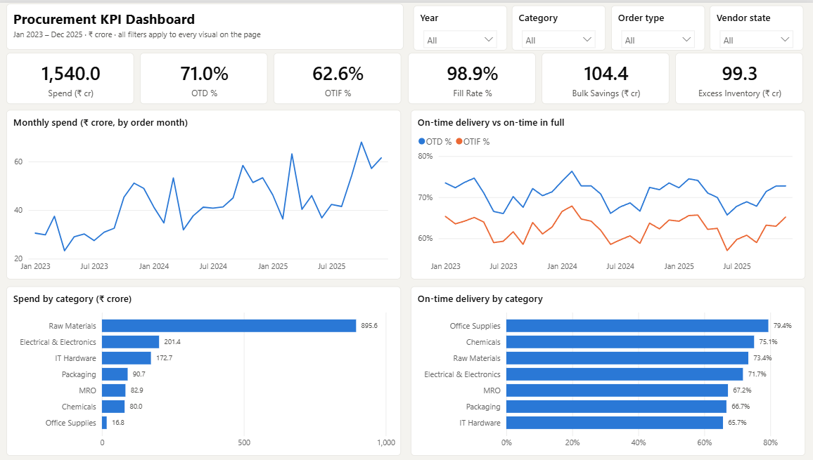
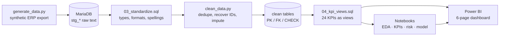
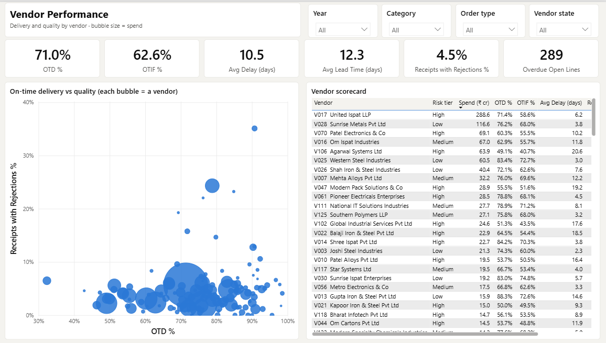
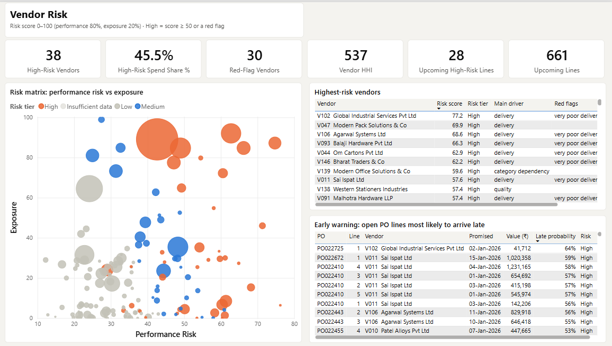
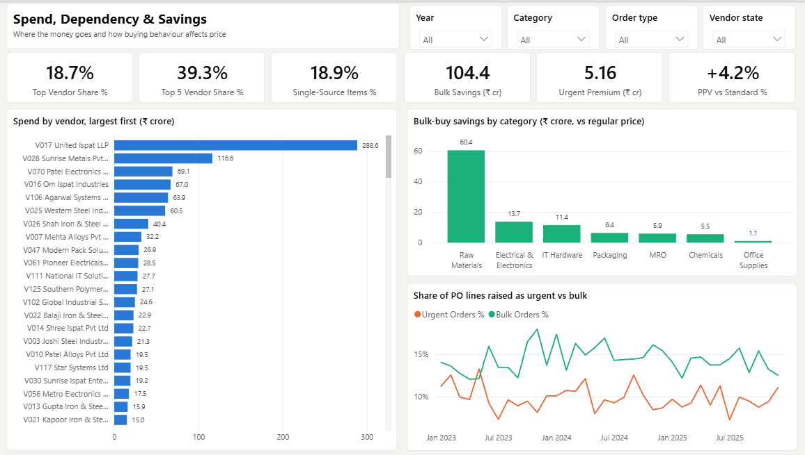
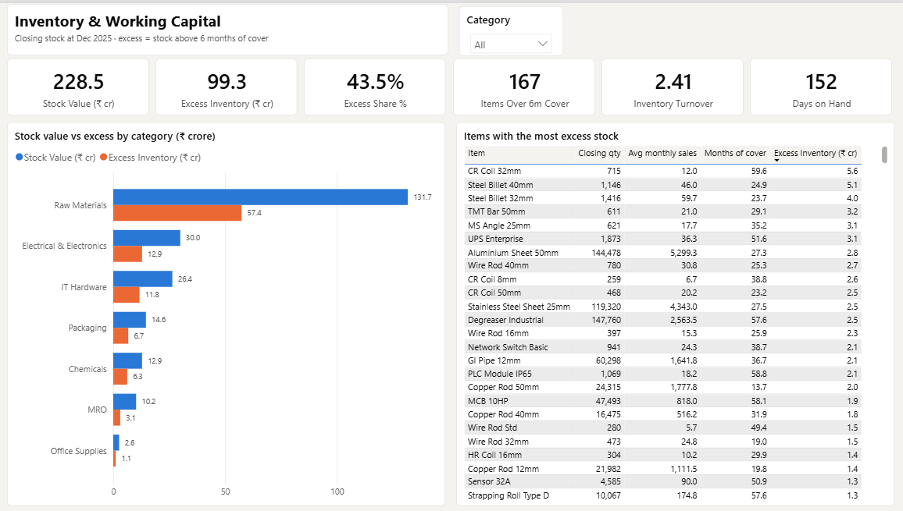

# Procurement Efficiency through Vendor KPI Development & Risk Analytics

End-to-end procurement analytics on **50,000 purchase-order lines** (Jan 2023 – Dec 2025):
- messy ERP-style data is cleaned with **SQL + Python**;
- turned into **24 vendor KPIs**;
- scored for **vendor risk**;
- used to **predict late deliveries**;
- presented in a 6-page **Power BI** dashboard.



## Key results

| Area | Result |
|---|---|
| Delivery | **71.0% on-time**, 62.6% on-time-in-full, flat for three years. Fill rate is 98.9%, so the problem is *timing*, not quantity |
| Vendor dependency | One vendor holds **18.7%** of spend (32% of Raw Materials); the top 5 hold **39.3%**; 19% of items are single-source |
| Buying behaviour | **₹104.4 crore** realised bulk-buy savings (13.1% like-for-like discount); ₹5.2 crore premium paid on urgent orders |
| Inventory | **₹99.3 crore (43.5%)** of stock sits above 6 months of cover; turnover is 2.4× (152 days on hand) |
| Vendor risk | **38 High-risk vendors hold 45.5% of spend**; the ranking is robust to weighting (rank correlation 0.90–0.98) |
| Re-sourcing scenario | Moving ₹102 crore to qualified, more reliable alternatives (capacity-capped) lifts on-time delivery on that volume from **59% to 79%** and cuts its lead time by **31%** |
| Late-delivery model | ROC-AUC 0.674 on a time-based test set. That is 92% of the best achievable (0.690); the riskiest decile is late 51% of the time vs 9% for the safest |

> **About the data:** the dataset is **synthetic**, generated by `src/generate_data.py` to behave like a mid-sized Indian
> manufacturer's procurement records.
> - It has realistic patterns: Pareto spend, unreliable vendors, monsoon delays, bulk discounts, over-ordering.
> - It has realistic data-quality problems: duplicates, mixed date formats, ₹-formatted text prices, misspelt vendor names and orphan records.
> - A clean "ground truth" copy is kept separately. It is used **only** to measure how well the cleaning and analysis
>   recover the truth, never as an input.

## Pipeline



| Stage | What it does | Main files |
|---|---|---|
| 1. Data | 6 linked tables: vendors, items, POs, deliveries, sales, inventory | `src/generate_data.py`, `reports/data_dictionary.md` |
| 2. Profiling | 69 data-quality checks with a handling rule for each | `src/profile_raw.py` → `reports/raw_data_profile.md` |
| 3. Database | Raw text staging tables plus typed clean tables with constraints | `sql/01_schema.sql`, `src/load_raw.py`, `sql/02_staging_checks.sql` |
| 4. Cleaning | SQL standardisation views + Python rules; every removed row is logged | `sql/03_standardize.sql`, `src/clean_data.py`, `reports/cleaning_log.md` |
| 5. Validation | Cleaned data scored against ground truth | `src/validate_cleaning.py` → `reports/cleaning_validation.md` |
| 6. EDA | Spend, seasonality, lead times, delays, quality, inventory | `notebooks/02_eda.ipynb`, `reports/eda_findings.md` |
| 7. KPIs | 24 KPIs as SQL views, each recomputed in pandas | `sql/04_kpi_views.sql`, `notebooks/03_kpis.ipynb`, `reports/kpi_report.md` |
| 8. Risk | Vendor risk score, re-sourcing scenario, late-delivery model | `notebooks/04_risk_score.ipynb`, `notebooks/05_delay_model.ipynb`, `reports/risk_report.md` |
| 9. Dashboard | Power BI project generated from code | `src/export_powerbi_data.py`, `src/build_powerbi.py`, `dashboard/` |

## Highlights

**Data cleaning, validated**
- 35 issue types fixed across 6 tables. Examples:
  - three mixed date formats (DD/MM proven from 6,051 unambiguous dates);
  - prices entered in paise (×100);
  - 1,481 missing vendor IDs, all recovered from the same PO or by fuzzy name matching;
  - duplicate vendor registrations;
  - goods receipts against non-existent POs.
- **100% of 699,855 corrected values match the ground truth.** Imputed prices are within 10% for 98.3% of lines.
- 2,125 removed rows are kept in a `rejected_rows` table with the reason. Every fixed row carries `dq_flags`.

**KPIs you can trust**
- All 24 KPIs are defined once in SQL. An independent pandas implementation agrees on **24 of 24**.
- **Right-censoring is handled:** at the data cut-off, late lines simply haven't arrived yet. Overdue undelivered lines therefore count as late. Without this, recent on-time rates would look inflated.
- **Price benchmark:** stale standard costs (regular prices +15% above standard by 2025) are replaced by a market benchmark, and bulk savings are measured like-for-like.
- **Stock reconciliation:** opening + receipts − sales = closing stock is checked per item. The check exposed a flaw in the data generator, which was fixed at the source.

**Risk analytics**
- **Risk score:** performance (80%) plus exposure (20%), with **red-flag overrides** so one severe problem is not averaged away.
  It flags 30 of the 38 planted problem vendors, with 8 false alarms out of 110 clean vendors.
- **Re-sourcing scenario:** realistic constraints apply. The alternative must have supplied the same item, must be at least as punctual, and can take at most +50% extra volume.
- **Delay model:** no look-ahead features (vendor history uses only outcomes known at order date) and a time-based train/test split.
  It produces an early-warning list of open POs likely to arrive late.

**Dashboard as code**
- The Power BI report is a **PBIP project** (TMDL semantic model, 34 DAX measures, 5 relationships, 6 pages) generated by `src/build_powerbi.py`.
- Every DAX measure was queried through Power BI's engine and matches the SQL KPIs.

| | |
|---|---|
|  |  |
|  |  |

More charts are in [`reports/figures/`](reports/figures), e.g. the [vendor risk matrix](reports/figures/18_vendor_risk_matrix.png),
the [monsoon effect](reports/figures/11_monsoon_on_time.png) and the [re-sourcing scenario](reports/figures/20_resourcing_scenario.png).

## Tech stack
- **Python:** pandas, NumPy, scikit-learn, matplotlib, SQLAlchemy, rapidfuzz, Jupyter
- **SQL:** MariaDB 10.4 / MySQL. Uses CTEs, window functions, `MEDIAN() OVER`, views, stored functions and constraints.
- **Power BI Desktop:** PBIP / TMDL, DAX, Power Query (M)

## How to run

Requirements:
- Python 3.11
- a local MySQL/MariaDB (e.g. XAMPP; defaults: `root`, no password, `localhost:3306`; override with `DB_USER`, `DB_PASSWORD`, `DB_HOST`, `DB_PORT`)
- Power BI Desktop for the dashboard

```bash
python -m venv .venv
.venv/Scripts/pip install -r requirements.txt
```

1. Generate the data:

```bash
.venv/Scripts/python src/generate_data.py
```

2. Profile the raw data:

```bash
.venv/Scripts/python src/profile_raw.py
```

3. Create the database:

```bash
mysql -u root < sql/01_schema.sql
```

4. Load the raw data:

```bash
.venv/Scripts/python src/load_raw.py
```

5. Create the standardisation views:

```bash
mysql -u root --default-character-set=utf8mb4 procurement_db < sql/03_standardize.sql
```

6. Clean the data:

```bash
.venv/Scripts/python src/clean_data.py
```

7. Score the cleaning against the ground truth:

```bash
.venv/Scripts/python src/validate_cleaning.py
```

8. Create the KPI views:

```bash
mysql -u root --default-character-set=utf8mb4 procurement_db < sql/04_kpi_views.sql
```

9. Run the notebooks in order (`02_eda` → `05_delay_model`). They read from the database and write `reports/` and the risk tables.

10. Export the dashboard data:

```bash
.venv/Scripts/python src/export_powerbi_data.py
```

11. Open `dashboard/Procurement KPI Dashboard.pbip` in Power BI Desktop. If your project folder is elsewhere, set the `ProjectFolder` parameter (Transform data → Manage parameters), then press **Refresh**.

## Repository layout

```
├── src/          data generation, profiling, loading, cleaning, validation, Power BI export & build
├── sql/          schema, staging checks, standardisation views, KPI views
├── notebooks/    02_eda · 03_kpis · 04_risk_score · 05_delay_model
├── data/
│   ├── raw/      messy generated input
│   ├── truth/    ground truth (evaluation only)
│   ├── clean/    cleaned tables
│   └── powerbi/  dashboard data
├── reports/      data dictionary, profile, cleaning log & validation, EDA / KPI / risk reports, figures, KPI & risk exports
└── dashboard/    Power BI project (.pbip) and page screenshots
```

## Limitations
- The data is synthetic. The patterns are realistic, but the specific numbers describe the simulation, not a real company.
- The scenario uses each vendor's historical rates and an assumed +50% capacity limit. Switching costs and supplier performance under extra load are not modelled.
- Late deliveries are partly random by design, which caps achievable model accuracy (AUC ≈ 0.69).
